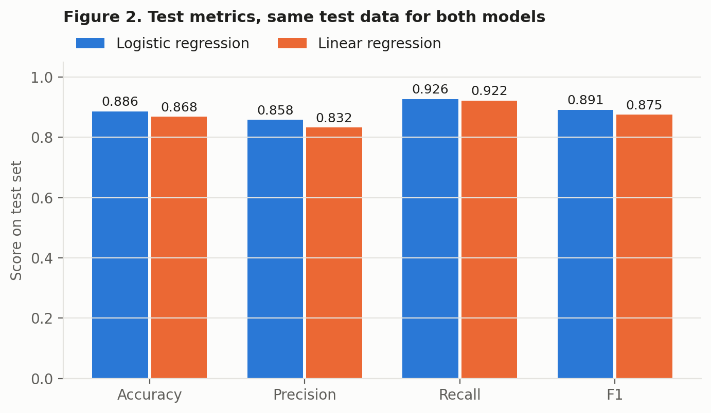
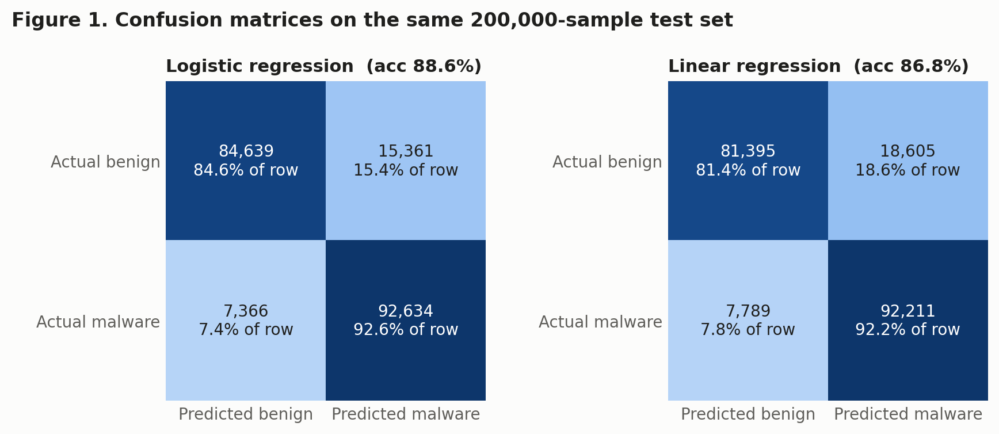
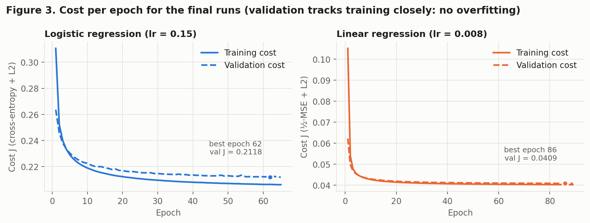
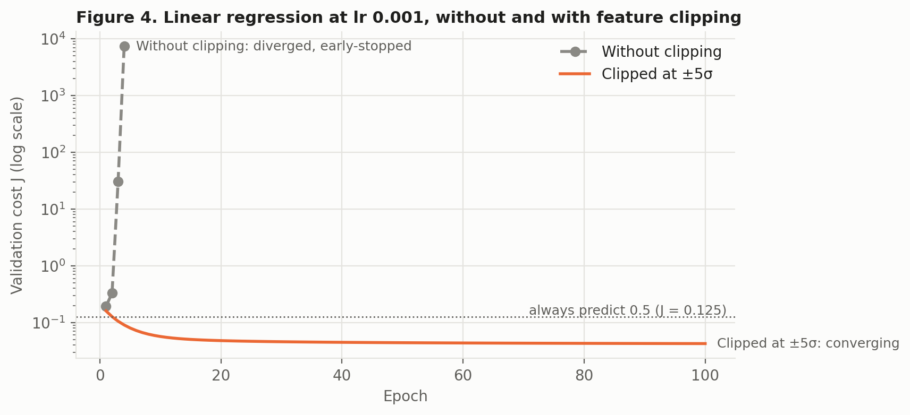
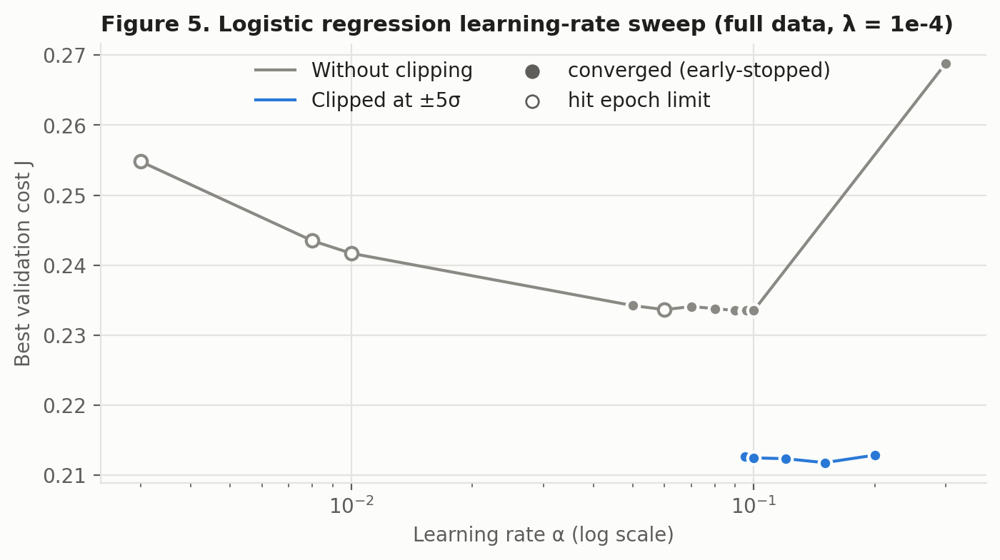
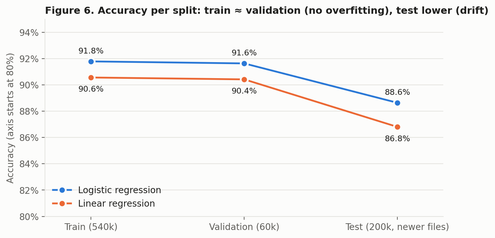
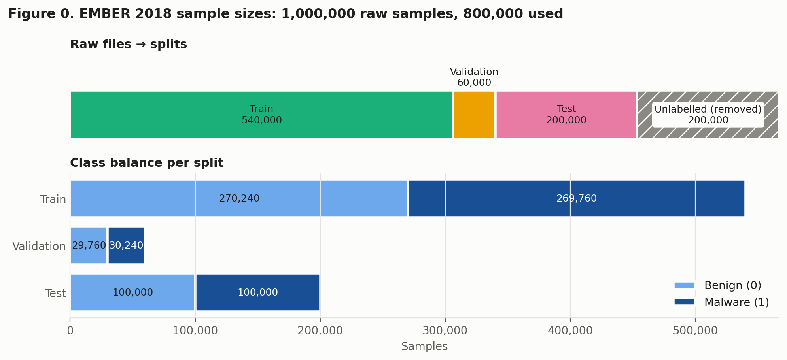
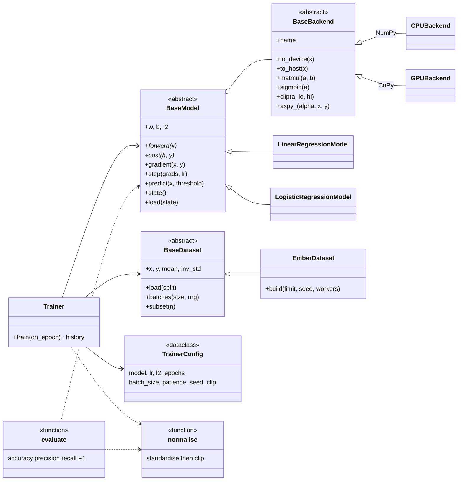

# simple-regression-models

**English** · [Türkçe](README.tr.md)

Linear and logistic regression, written from scratch, used to classify Windows
executables as **benign (0)** or **malware (1)** on the EMBER 2018 dataset.
Both models are trained with mini-batch gradient descent on NumPy (CPU) or CuPy
(GPU), use L2 regularisation and early stopping, and are compared on the same
200,000-sample test set. A Streamlit dashboard trains, evaluates and compares runs
interactively.

No machine-learning library implements the models: the hypothesis, cost,
gradient and update step are in [`base/base_model.py`](base/base_model.py) and
[`models/models.py`](models/models.py). NumPy/CuPy are used only for array
maths; the `ember` package is used only to extract features from the raw data.

## Results

Final models, each chosen by lowest validation cost, with features clipped at ±5σ.
Both are evaluated on the **same** test set (200,000 samples, 50% malware).

| Model | Learning rate α | Epochs (best) | Accuracy | Precision | Recall | F1 |
| --- | --- | --- | --- | --- | --- | --- |
| **Logistic regression** | 0.15 | 65 (62) | **88.6%** | **85.8%** | **92.6%** | **0.891** |
| Linear regression | 0.008 | 89 (86) | 86.8% | 83.2% | 92.2% | 0.875 |

| Model | Train accuracy | Validation accuracy | Test accuracy |
| --- | --- | --- | --- |
| Logistic regression | 91.8% | 91.6% | 88.6% |
| Linear regression | 90.6% | 90.4% | 86.8% |

What the numbers show:

- **Logistic beats linear by 1.8 points**, almost entirely through precision
  (about 3,200 fewer false alarms). Both draw a linear decision boundary; they
  differ only in the cost used to place it. Squared error also penalises
  predictions that are "too correct", which pulls the boundary away from the
  cross-entropy optimum.
- **The data is not linearly separable.** Even on the training data, the best
  linear boundary reaches only about 92%. Train ≈ validation, so the models are
  not overfitting: the remaining error is bias from the linear hypothesis.
- **Temporal drift costs about 3 points.** The EMBER test files are newer than
  the training files, so test accuracy is lower than validation accuracy.
- **Feature clipping is essential for linear regression.** Some standardised
  features reach 700σ. Under squared error the gradient grows with ‖x‖², so
  linear regression diverged without clipping. Clipping at ±5σ fixed it and also
  improved logistic regression (87.9% → 88.6%).
- **CPU and GPU give identical results.** On a GTX 1660 Ti one epoch takes about
  0.7 s, against about 2.75 s on the CPU (about 4× faster).
- For reference, a published logistic regression on the same split reports
  87.4% accuracy, and the non-linear LightGBM baseline reaches 93.6%
  ([arXiv 2212.13988](https://arxiv.org/pdf/2212.13988)).




<details>
<summary>More figures (cost curves, clipping, learning-rate sweep, per-split accuracy)</summary>






</details>

## Dataset

[EMBER 2018](https://github.com/elastic/ember) (feature version 2): 2,381
numeric features extracted from Windows PE files, in groups such as general
file information, header, sections, imports, exports, strings, byte histogram,
byte-entropy histogram and data directories.

| Split | Samples | Benign | Malware | Source |
| --- | --- | --- | --- | --- |
| Train | 540,000 | 270,240 | 269,760 | 90% of labelled training files |
| Validation | 60,000 | 29,760 | 30,240 | 10% of labelled training files (random) |
| Test | 200,000 | 100,000 | 100,000 | EMBER test file (newer samples) |
| Removed | 200,000 | | | Unlabelled rows (`label = -1`) in the training files |



Preprocessing, in order: drop unlabelled rows, extract features, shuffle and
split train/validation (seed 0), standardise with the **training** split's mean
and standard deviation, clip to ±5σ. The test set never supplies its own
statistics and is never used for model selection.

## Method

| | Linear regression | Logistic regression |
| --- | --- | --- |
| Hypothesis h(x) | w·x + b | σ(w·x + b) |
| Cost J | ½·mean((h − y)²) + ½λ‖w‖² | −mean(y·log h + (1−y)·log(1−h)) + ½λ‖w‖² |
| Gradient | ∂J/∂w = (1/m)·Xᵀ(h − y) + λw, ∂J/∂b = mean(h − y) | same form |
| Prediction | malware if h(x) ≥ 0.5 | malware if h(x) ≥ 0.5 |

Training: mini-batch gradient descent (batch size 4,096), shuffled batch order
each epoch, L2 with λ = 1e-4, early stopping with patience 3 on validation cost,
and the best validation weights restored at the end.

## Class diagram



How the pieces connect at run time: `main.run_training` (used by both the CLI and
the Streamlit app) builds a model through `MODEL_CLASSES`, trains it with
`Trainer`, saves it with `save_model`, and scores it with `evaluate`.

## Repository layout

```
backend/        CPUBackend (NumPy), GPUBackend (CuPy), get_backend()
base/           abstract BaseBackend, BaseModel, BaseDataset; normalise(); logging
models/         LinearRegressionModel, LogisticRegressionModel
training/       TrainerConfig, Trainer (early stopping, on_epoch callback); save/load
benchmark/      evaluate(), eval_splits.py, figures.py
dataset/        pull_dataset.py (download), parse_dataset.py (build splits)
main.py         command-line training and evaluation
app.py          Streamlit dashboard
tests/          unit and integration tests (synthetic data, no downloads)
report/figures/ generated figures (English; tr/ = Turkish)
runs/           one folder per run (git-ignored)
```

## Setup

Python 3.12 or newer. From the repository root:

```powershell
python -m venv .venv
.\.venv\Scripts\Activate.ps1
python -m pip install -e ".[ember]"
python -m pip install pytest matplotlib
```

With uv: `uv pip install -e ".[ember]"` and `uv pip install pytest matplotlib`.
For the GPU, install the CuPy build that matches your CUDA version (for example
`cupy-cuda12x` or `cupy-cuda13x`).

## Build the dataset

```powershell
python -m dataset.pull_dataset      # download and verify the raw EMBER 2018 files
python -m dataset.parse_dataset     # build dataset/processed/ember2018 (about 3 minutes)
```

A completed build is skipped on later runs. For a small, quick dataset, sample
rows at random into a separate folder:

```powershell
python -m dataset.parse_dataset --limit 20000 --out-dir dataset/processed/ember2018_quick
```

`--limit` samples randomly across all training files (seeded), and the build
fails if any split ends up with only one class.

## Command line

Train, save and evaluate one model:

```powershell
python main.py --model logistic --lr 0.15 --epochs 200
python main.py --model linear --lr 0.008 --epochs 200
```

| Flag | Default | Meaning |
| --- | --- | --- |
| `--model` | `logistic` | `linear` or `logistic` |
| `--lr` | `0.1` | learning rate α |
| `--l2` | `1e-4` | L2 regularisation λ |
| `--epochs` | `10` | maximum epochs (early stopping usually ends sooner) |
| `--batch-size` | `4096` | mini-batch size |
| `--patience` | `3` | epochs without validation improvement before stopping |
| `--clip` | `5` | clip standardised features to ±clip; `0` turns clipping off |
| `--seed` | `0` | batch-order seed |
| `--limit-rows` | | use only the first N training rows (quick experiments) |
| `--data-dir` | | use another processed dataset folder |
| `--run-dir` | | output folder (default: a new folder in `runs/`) |

Use the GPU by setting the backend before running (PowerShell):

```powershell
$env:MATH_BACKEND = "cupy"        # Remove-Item Env:MATH_BACKEND to go back to CPU
$env:CUDA_DEVICE = "0"            # optional
```

Each run writes a folder in `runs/` with `model.npz` (best weights, training
statistics and config), `history.json` (cost per epoch), `test_metrics.json`,
`metrics.jsonl` (structured log with per-epoch timing) and `run.log`. The
confusion matrix is stored as `[[TN, FP], [FN, TP]]`.

Other commands:

```powershell
python -m benchmark.eval_splits runs/<run-folder>   # accuracy/precision/recall/F1 on train, val and test
python -m benchmark.figures                         # redraw report/figures/*.png
python -m benchmark.figures --lang tr               # Turkish versions in report/figures/tr/
```

## Streamlit dashboard

```powershell
streamlit run app.py
```

To use a quick dataset, set `$env:EMBER_PROCESSED_DIR = "dataset/processed/ember2018_quick"` first.

- **Sidebar:** choose the model (linear or logistic), learning rate, L2 (λ),
  epochs, batch size, patience, clipping and the number of training rows. The
  active backend (CPU or GPU) is shown at the top.
- **Train:** starts training. The cost chart (training and validation cost) and
  the progress bar update after every epoch, and the status line says whether
  training finished or stopped early. The run is saved to `runs/` automatically.
- **Test results:** accuracy, precision, recall and F1 tiles, the confusion
  matrix, and the full cost history. Results stay on screen when you change
  widgets.
- **Saved runs:** pick any `runs/*/model.npz` and press **Load and evaluate** to
  score it on the test set with its own saved statistics and clipping, so old
  runs can be compared without retraining.
- If the dataset has not been built, the page shows the build command instead.

## Tests

```powershell
python -m pytest
```

Use `python -m pytest` rather than bare `pytest` so the virtual environment's
Python runs the tests and the repository root is importable. The 32 tests use
small synthetic datasets and need no download:

| File | What it checks |
| --- | --- |
| `test_evaluate.py` | hand-computed confusion counts for both models across partial batches, constant predictions, missing positive class, empty data, reloaded models using their saved statistics |
| `test_training.py` | the `on_epoch` callback matches the history, early stopping restores the best weights, invalid configs and non-finite costs are rejected |
| `test_pipeline.py` | the CLI trains, saves, evaluates and logs both models end to end |
| `test_app.py` | the Streamlit app shows the build command without data, and trains, reruns, saves and loads a model |
| `test_pull_dataset.py` | download, checksum, extraction and caching of the raw dataset |
