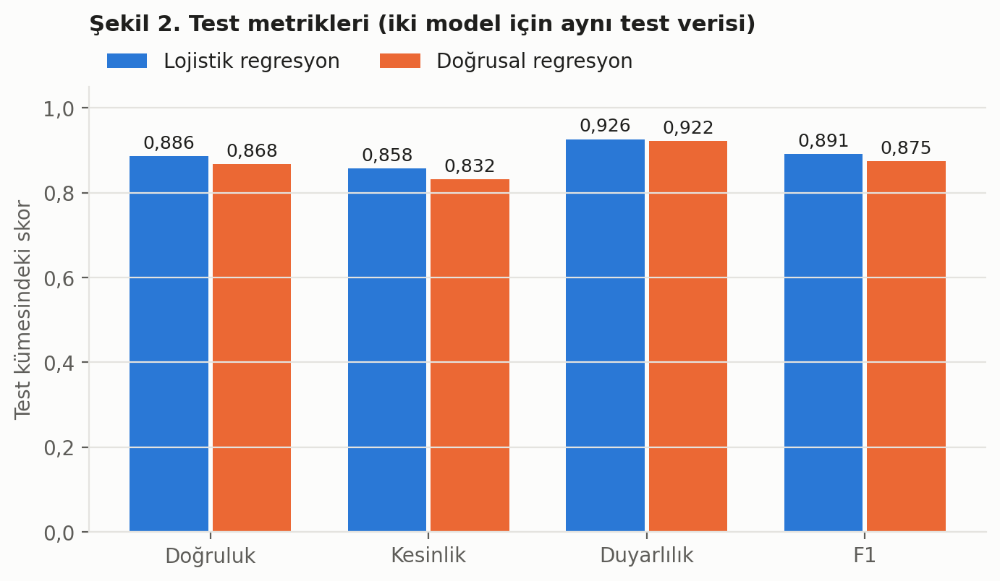
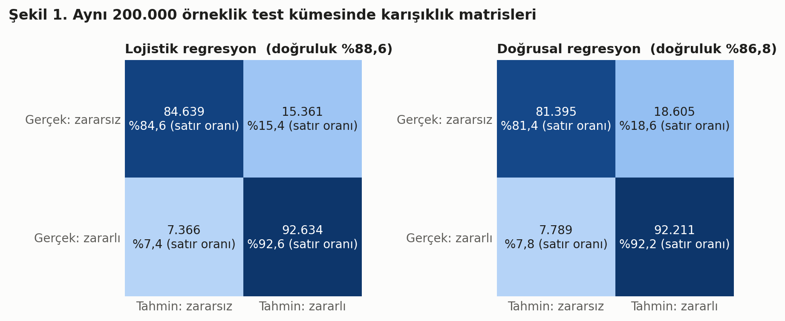
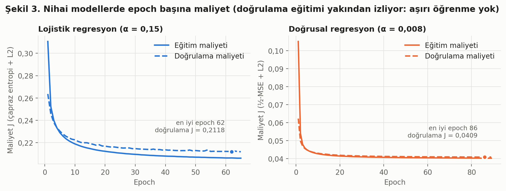
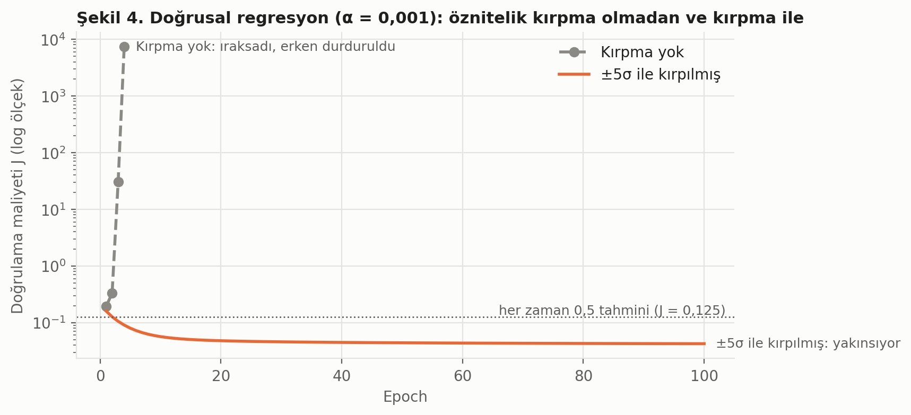
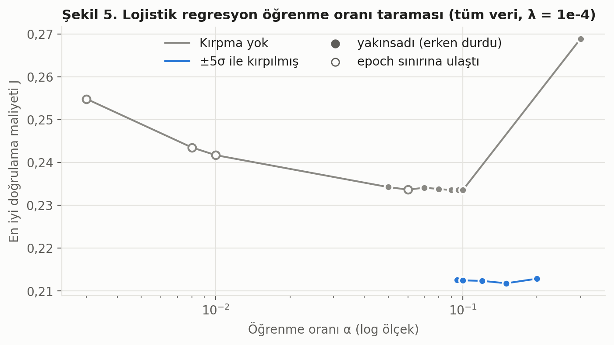
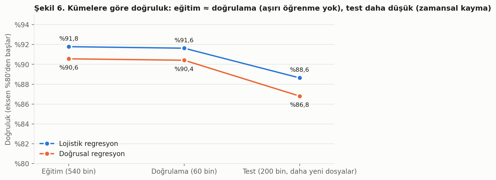
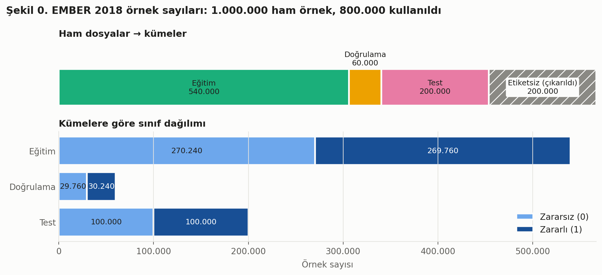
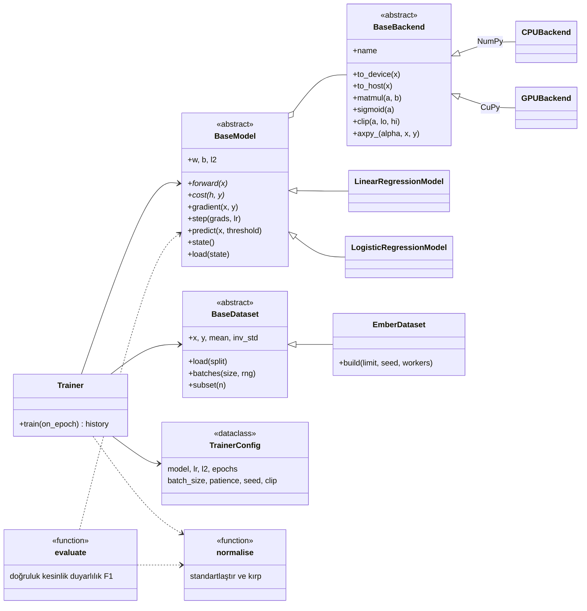

# simple-regression-models

[English](README.md) · **Türkçe**

Sıfırdan yazılmış doğrusal ve lojistik regresyon ile EMBER 2018 veri kümesindeki
Windows çalıştırılabilir dosyalarının **zararsız (0)** veya **zararlı (1)** olarak
sınıflandırılması. İki model de NumPy (CPU) veya CuPy (GPU) üzerinde mini-yığın
gradyan inişi ile eğitilir, L2 düzenlileştirme ve erken durdurma kullanır ve aynı
200.000 örneklik test kümesinde karşılaştırılır. Bir Streamlit paneli, eğitimi,
değerlendirmeyi ve çalıştırmaların karşılaştırılmasını etkileşimli olarak sunar.

Modelleri doğrudan uygulayan hiçbir makine öğrenimi kütüphanesi kullanılmamıştır:
hipotez, maliyet, gradyan ve güncelleme adımı
[`base/base_model.py`](base/base_model.py) ve [`models/models.py`](models/models.py)
dosyalarındadır. NumPy/CuPy yalnızca dizi işlemleri için, `ember` paketi ise
yalnızca ham veriden öznitelik çıkarmak için kullanılır.

## Sonuçlar

Nihai modeller, en düşük doğrulama maliyetine göre seçilmiştir; öznitelikler ±5σ
ile kırpılmıştır. İki model de **aynı** test kümesinde değerlendirilmiştir
(200.000 örnek, %50 zararlı).

| Model | Öğrenme oranı α | Epoch (en iyi) | Doğruluk | Kesinlik | Duyarlılık | F1 |
| --- | --- | --- | --- | --- | --- | --- |
| **Lojistik regresyon** | 0,15 | 65 (62) | **%88,6** | **%85,8** | **%92,6** | **0,891** |
| Doğrusal regresyon | 0,008 | 89 (86) | %86,8 | %83,2 | %92,2 | 0,875 |

| Model | Eğitim doğruluğu | Doğrulama doğruluğu | Test doğruluğu |
| --- | --- | --- | --- |
| Lojistik regresyon | %91,8 | %91,6 | %88,6 |
| Doğrusal regresyon | %90,6 | %90,4 | %86,8 |

Sonuçların gösterdikleri:

- **Lojistik regresyon, doğrusal regresyonu 1,8 puan geçer.** Farkın neredeyse
  tamamı kesinlikten gelir (yaklaşık 3.200 daha az yanlış alarm). İki model de
  doğrusal bir karar sınırı çizer; yalnızca sınırı yerleştirmek için kullanılan
  maliyet fonksiyonu farklıdır. Kare hata, "fazla doğru" tahminleri de
  cezalandırdığı için sınırı çapraz entropi optimumundan uzaklaştırır.
- **Veri doğrusal olarak ayrılabilir değildir.** Eğitim verisinde bile en iyi
  doğrusal sınır yalnızca yaklaşık %92'ye ulaşır. Eğitim ≈ doğrulama olduğundan
  aşırı öğrenme yoktur: kalan hata, doğrusal hipotezin yanlılığından (bias) gelir.
- **Zamansal kayma yaklaşık 3 puana mal olur.** EMBER test dosyaları eğitim
  dosyalarından daha yenidir; bu yüzden test doğruluğu doğrulama doğruluğundan
  düşüktür.
- **Öznitelik kırpma, doğrusal regresyon için zorunludur.** Standartlaştırılmış
  bazı öznitelikler 700σ'ya ulaşır. Kare hatada gradyan ‖x‖² ile büyüdüğü için
  doğrusal regresyon kırpma olmadan ıraksadı. ±5σ ile kırpma bunu çözdü ve
  lojistik regresyonu da iyileştirdi (%87,9 → %88,6).
- **CPU ve GPU aynı sonuçları verir.** GTX 1660 Ti üzerinde bir epoch yaklaşık
  0,7 s, CPU'da ise yaklaşık 2,75 s sürer (yaklaşık 4 kat hızlı).
- Karşılaştırma için, aynı ayrımda yayımlanmış bir lojistik regresyon %87,4
  doğruluk, doğrusal olmayan LightGBM temel modeli ise %93,6 doğruluk bildirir
  ([arXiv 2212.13988](https://arxiv.org/pdf/2212.13988)).




<details>
<summary>Diğer şekiller (maliyet eğrileri, kırpma, öğrenme oranı taraması, kümelere göre doğruluk)</summary>






</details>

## Veri kümesi

[EMBER 2018](https://github.com/elastic/ember) (öznitelik sürümü 2): Windows PE
dosyalarından çıkarılmış 2.381 sayısal öznitelik. Öznitelik grupları: genel dosya
bilgileri, başlık (header), bölümler (sections), içe aktarımlar (imports), dışa
aktarımlar (exports), karakter dizileri (strings), bayt histogramı, bayt-entropi
histogramı ve veri dizinleri (data directories).

| Küme | Örnek | Zararsız | Zararlı | Kaynak |
| --- | --- | --- | --- | --- |
| Eğitim | 540.000 | 270.240 | 269.760 | Etiketli eğitim dosyalarının %90'ı |
| Doğrulama | 60.000 | 29.760 | 30.240 | Etiketli eğitim dosyalarının %10'u (rastgele) |
| Test | 200.000 | 100.000 | 100.000 | EMBER test dosyası (daha yeni örnekler) |
| Çıkarılan | 200.000 | | | Eğitim dosyalarındaki etiketsiz satırlar (`label = -1`) |



Ön işleme adımları sırasıyla: etiketsiz satırları çıkarma, öznitelik çıkarma,
eğitim/doğrulama kümelerini karıştırıp ayırma (tohum 0), **eğitim** kümesinin
ortalaması ve standart sapmasıyla standartlaştırma, ±5σ ile kırpma. Test kümesi
kendi istatistiklerini hiçbir zaman sağlamaz ve model seçiminde kullanılmaz.

## Yöntem

| | Doğrusal regresyon | Lojistik regresyon |
| --- | --- | --- |
| Hipotez h(x) | w·x + b | σ(w·x + b) |
| Maliyet J | ½·ortalama((h − y)²) + ½λ‖w‖² | −ortalama(y·log h + (1−y)·log(1−h)) + ½λ‖w‖² |
| Gradyan | ∂J/∂w = (1/m)·Xᵀ(h − y) + λw, ∂J/∂b = ortalama(h − y) | aynı biçim |
| Tahmin | h(x) ≥ 0,5 ise zararlı | h(x) ≥ 0,5 ise zararlı |

Eğitim: mini-yığın gradyan inişi (yığın boyutu 4.096), her epoch'ta karıştırılan
yığın sırası, λ = 1e-4 ile L2 düzenlileştirme, doğrulama maliyetine göre sabrı 3
olan erken durdurma ve sonunda en iyi doğrulama ağırlıklarının geri yüklenmesi.

## Sınıf diyagramı



Çalışma zamanında parçalar şöyle bağlanır: `main.run_training` (hem komut satırı
hem de Streamlit uygulaması tarafından kullanılır) `MODEL_CLASSES` üzerinden bir
model oluşturur, `Trainer` ile eğitir, `save_model` ile kaydeder ve `evaluate`
ile puanlar.

## Depo yapısı

```
backend/        CPUBackend (NumPy), GPUBackend (CuPy), get_backend()
base/           soyut BaseBackend, BaseModel, BaseDataset; normalise(); kayıt (logging)
models/         LinearRegressionModel, LogisticRegressionModel
training/       TrainerConfig, Trainer (erken durdurma, on_epoch geri çağrısı); kaydet/yükle
benchmark/      evaluate(), eval_splits.py, figures.py
dataset/        pull_dataset.py (indirme), parse_dataset.py (kümeleri oluşturma)
main.py         komut satırından eğitim ve değerlendirme
app.py          Streamlit paneli
tests/          birim ve entegrasyon testleri (sentetik veri, indirme gerekmez)
report/figures/ üretilen şekiller (İngilizce; tr/ = Türkçe)
runs/           her çalıştırma için bir klasör (git tarafından yok sayılır)
```

## Kurulum

Python 3.12 veya üzeri. Depo kök dizininden:

```powershell
python -m venv .venv
.\.venv\Scripts\Activate.ps1
python -m pip install -e ".[ember]"
python -m pip install pytest matplotlib
```

uv ile: `uv pip install -e ".[ember]"` ve `uv pip install pytest matplotlib`.
GPU için CUDA sürümünüze uygun CuPy paketini kurun (örneğin `cupy-cuda12x` veya
`cupy-cuda13x`).

## Veri kümesini oluşturma

```powershell
python -m dataset.pull_dataset      # ham EMBER 2018 dosyalarını indir ve doğrula
python -m dataset.parse_dataset     # dataset/processed/ember2018 oluştur (yaklaşık 3 dakika)
```

Tamamlanmış bir derleme sonraki çalıştırmalarda atlanır. Küçük ve hızlı bir veri
kümesi için satırları rastgele örnekleyip ayrı bir klasöre yazın:

```powershell
python -m dataset.parse_dataset --limit 20000 --out-dir dataset/processed/ember2018_quick
```

`--limit`, tüm eğitim dosyalarından (tohumlu) rastgele örnekler; herhangi bir küme
tek sınıftan oluşursa derleme hata verir.

## Komut satırı

Bir modeli eğitme, kaydetme ve değerlendirme:

```powershell
python main.py --model logistic --lr 0.15 --epochs 200
python main.py --model linear --lr 0.008 --epochs 200
```

| Parametre | Varsayılan | Anlamı |
| --- | --- | --- |
| `--model` | `logistic` | `linear` (doğrusal) veya `logistic` (lojistik) |
| `--lr` | `0.1` | öğrenme oranı α |
| `--l2` | `1e-4` | L2 düzenlileştirme λ |
| `--epochs` | `10` | en fazla epoch sayısı (erken durdurma genellikle daha önce bitirir) |
| `--batch-size` | `4096` | mini-yığın boyutu |
| `--patience` | `3` | doğrulama iyileşmeden durmadan önce beklenen epoch sayısı |
| `--clip` | `5` | standartlaştırılmış öznitelikleri ±clip ile kırp; `0` kırpmayı kapatır |
| `--seed` | `0` | yığın sırası tohumu |
| `--limit-rows` | | yalnızca ilk N eğitim satırını kullan (hızlı denemeler) |
| `--data-dir` | | başka bir işlenmiş veri klasörü kullan |
| `--run-dir` | | çıktı klasörü (varsayılan: `runs/` içinde yeni bir klasör) |

GPU kullanmak için çalıştırmadan önce arka ucu seçin (PowerShell):

```powershell
$env:MATH_BACKEND = "cupy"        # CPU'ya dönmek için: Remove-Item Env:MATH_BACKEND
$env:CUDA_DEVICE = "0"            # isteğe bağlı
```

Her çalıştırma `runs/` içine bir klasör yazar: `model.npz` (en iyi ağırlıklar,
eğitim istatistikleri ve yapılandırma), `history.json` (epoch başına maliyet),
`test_metrics.json`, `metrics.jsonl` (epoch süreleri dahil yapılandırılmış kayıt)
ve `run.log`. Karışıklık matrisi `[[TN, FP], [FN, TP]]` biçiminde saklanır.

Diğer komutlar:

```powershell
python -m benchmark.eval_splits runs/<çalıştırma-klasörü>   # eğitim, doğrulama ve testte doğruluk/kesinlik/duyarlılık/F1
python -m benchmark.figures                                 # report/figures/*.png şekillerini yeniden çiz
python -m benchmark.figures --lang tr                       # Türkçe sürümler: report/figures/tr/
```

## Streamlit paneli

```powershell
streamlit run app.py
```

Hızlı veri kümesini kullanmak için önce `$env:EMBER_PROCESSED_DIR = "dataset/processed/ember2018_quick"` ayarlayın.

- **Kenar çubuğu:** model (doğrusal veya lojistik), öğrenme oranı, L2 (λ), epoch
  sayısı, yığın boyutu, sabır, kırpma ve eğitim satırı sayısı seçilir. Etkin arka
  uç (CPU veya GPU) en üstte gösterilir.
- **Train (Eğit):** eğitimi başlatır. Maliyet grafiği (eğitim ve doğrulama
  maliyeti) ve ilerleme çubuğu her epoch'tan sonra güncellenir; durum satırı
  eğitimin tamamlandığını veya erken durduğunu belirtir. Çalıştırma otomatik
  olarak `runs/` içine kaydedilir.
- **Test results (Test sonuçları):** doğruluk, kesinlik, duyarlılık ve F1
  kutucukları, karışıklık matrisi ve tüm maliyet geçmişi. Ayarlar değiştirildiğinde
  sonuçlar ekranda kalır.
- **Saved runs (Kayıtlı çalıştırmalar):** herhangi bir `runs/*/model.npz` seçilip
  **Load and evaluate** düğmesine basıldığında, model kendi kayıtlı istatistikleri
  ve kırpma ayarıyla test kümesinde puanlanır; böylece eski çalıştırmalar yeniden
  eğitilmeden karşılaştırılabilir.
- Veri kümesi oluşturulmamışsa sayfa bunun yerine derleme komutunu gösterir.

## Testler

```powershell
python -m pytest
```

Testlerin sanal ortamın Python'u ile çalışması ve depo kökünün içe aktarılabilmesi
için yalnızca `pytest` yerine `python -m pytest` kullanın. 32 test küçük sentetik
veri kümeleri kullanır ve indirme gerektirmez:

| Dosya | Neyi doğrular |
| --- | --- |
| `test_evaluate.py` | iki model için kısmi yığınlarda elle hesaplanmış karışıklık sayıları, sabit tahminler, pozitif sınıfın olmaması, boş veri, yeniden yüklenen modellerin kayıtlı istatistiklerini kullanması |
| `test_training.py` | `on_epoch` geri çağrısının geçmişle eşleşmesi, erken durdurmanın en iyi ağırlıkları geri yüklemesi, geçersiz yapılandırmaların ve sonlu olmayan maliyetlerin reddedilmesi |
| `test_pipeline.py` | komut satırının iki modeli uçtan uca eğitmesi, kaydetmesi, değerlendirmesi ve kaydını tutması |
| `test_app.py` | Streamlit uygulamasının veri yokken derleme komutunu göstermesi; bir modeli eğitmesi, yeniden çalıştırması, kaydetmesi ve yüklemesi |
| `test_pull_dataset.py` | ham veri kümesinin indirilmesi, sağlama toplamı, çıkarılması ve önbelleğe alınması |
